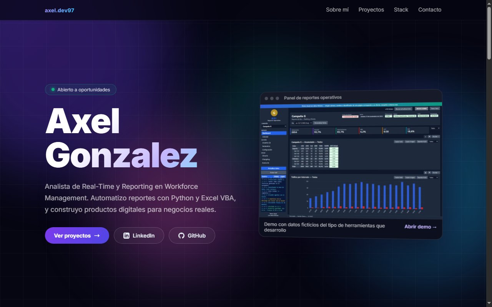

# Portfolio de Axel Gonzalez

**Sitio en vivo: [axeldev-portfolio.vercel.app](https://axeldev-portfolio.vercel.app)**



Portfolio personal de Axel Gonzalez, analista de Real-Time y Reporting en Workforce Management (Tafí Viejo, Tucumán, Argentina). Reúne las herramientas de reporting que desarrollo en mi trabajo, presentadas como demos con datos ficticios, y mis proyectos personales.

## Qué contiene

- **Sobre mí:** resultados medibles de mi trabajo y qué me diferencia.
- **Proyectos de trabajo:** el código real es privado, por lo que se muestran demos navegables con datos ficticios.
  - [Panel de reportes operativos](https://github.com/AGonzalez-97/contact-center-kpi-demo)
  - [Hub de postmortem mensual](https://github.com/AGonzalez-97/monthly-postmortem-demo)
- **Proyectos personales**, hechos como pasatiempo y con asistencia de IA:
  - [BarberApp](https://github.com/AGonzalez-97/BarberApp): PWA de turnos de barbería (Next.js, Supabase).
  - [HeadUnitLite](https://github.com/AGonzalez-97/HeadUnitLite): launcher para radios Android (Kotlin, Jetpack Compose), con demo en vivo.
- **Stack**, separado entre lo que uso en el trabajo y lo que usé en los proyectos personales.
- **Contacto:** [LinkedIn](https://www.linkedin.com/in/ahgonzalez97/) y [GitHub](https://github.com/AGonzalez-97).

## Cómo está hecho

- Un único archivo `index.html` con HTML, CSS y JavaScript propios. No hay paso de compilación ni dependencias de JavaScript; solo se carga la fuente Inter desde Google Fonts.
- Las imágenes de vista previa están en `assets/` en formato WebP.
- Diseño oscuro con efectos de vidrio, adaptable a celular, con navegación fija, barra de progreso de lectura y botón para volver arriba.
- Accesibilidad: enlaces con foco visible, texto alternativo en la imagen de portada y respeto por la preferencia de movimiento reducido del sistema.
- Se publica en [Vercel](https://vercel.com) de forma automática con cada cambio en la rama `master`.

## Ejecutarlo en local

No requiere instalación. Abrir `index.html` en el navegador, o servir la carpeta con cualquier servidor estático, por ejemplo:

```bash
python -m http.server 8000
```

y entrar a `http://localhost:8000`.

## Notas

- Las demos enlazadas usan datos ficticios y no contienen información de ninguna empresa ni cliente.
- Los resultados que menciona el sitio provienen de mi experiencia laboral. El código de esas herramientas no se publica por confidencialidad.
- Las capturas de `assets/` pertenecen a mis propias demos y proyectos.

## Contacto

Busco roles de Real-Time, WFM, reporting o análisis de datos operativos.
[LinkedIn](https://www.linkedin.com/in/ahgonzalez97/) · [GitHub](https://github.com/AGonzalez-97)
